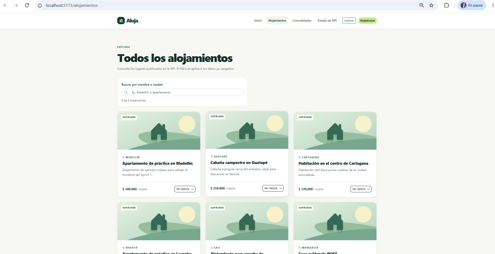
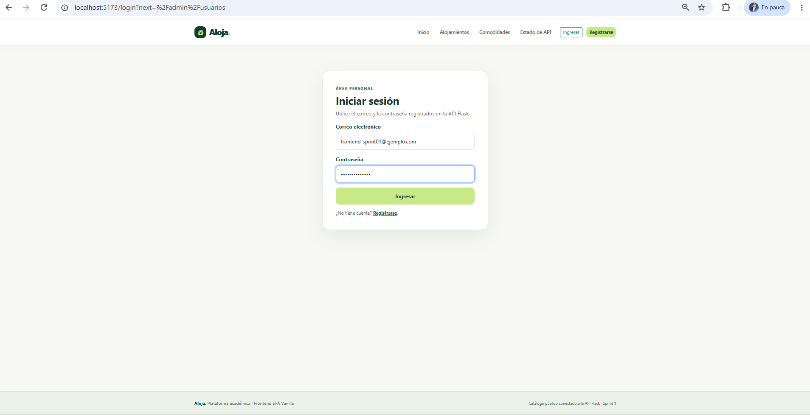
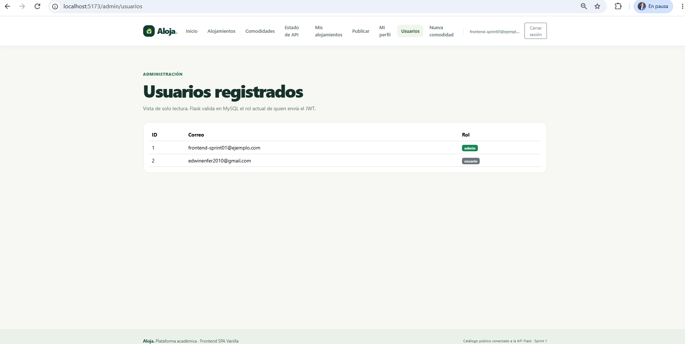
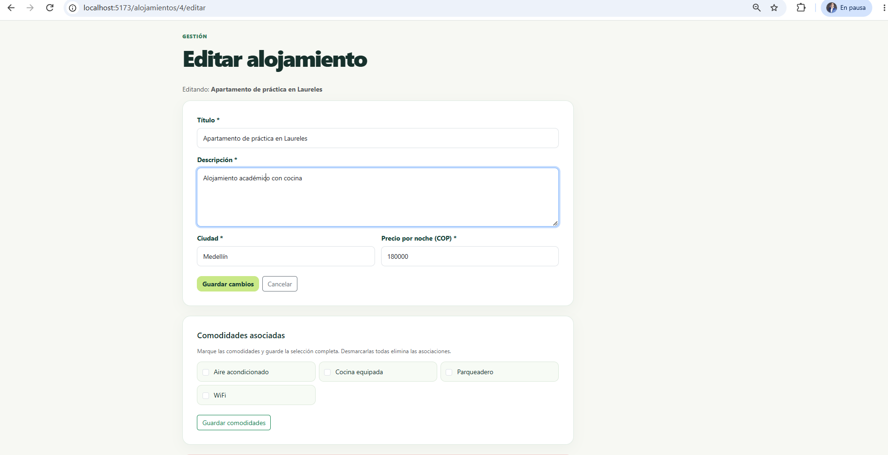
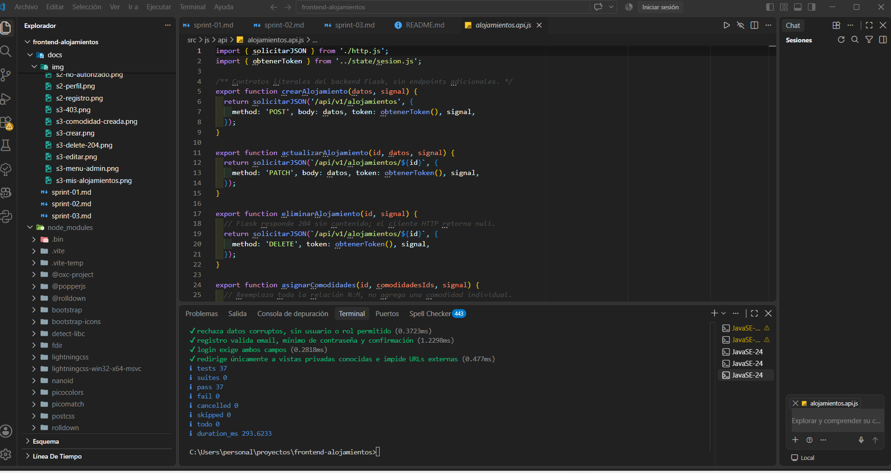
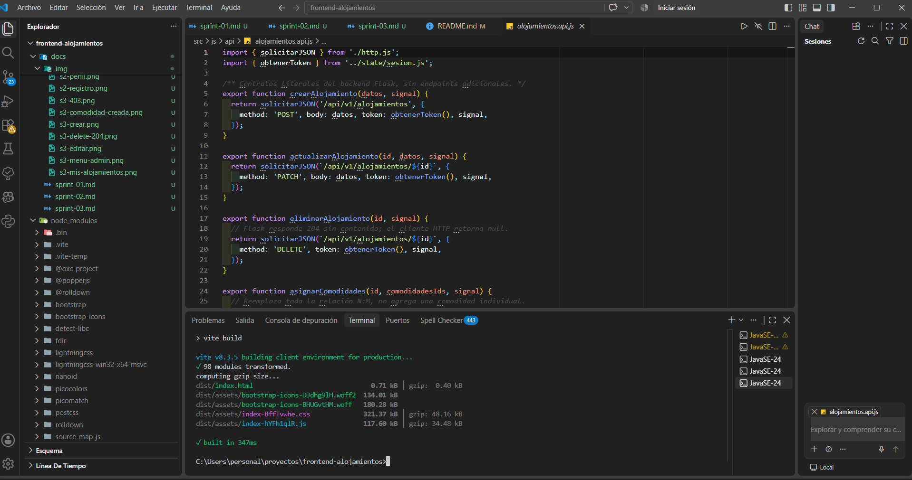

# Frontend Alojamientos (Aloja.)

Aplicación web de una sola página (SPA) para consultar y gestionar alojamientos turísticos. Está construida con HTML5, CSS3, JavaScript Vanilla (módulos ES), Vite, Bootstrap 5.3 y Bootstrap Icons, y consume la API REST **Alojamientos** desarrollada en Flask con MySQL.

- **Autor:** Edwin Alexis Cataño (GitHub [Ecatano](https://github.com/Ecatano))
- **Curso:** Módulo 4 Frontend: Lenguaje de programación. Prof. Rodolfo Ortega
- **Repositorio:** https://github.com/Ecatano/frontend-alojamientos
- **Versión:** entrega final (Trabajo 4). Integra los Sprints 1, 2 y 3.

---

## 1. Nombre y descripción del proyecto

**Frontend Alojamientos** es la interfaz web del sistema de alojamientos. Permite a cualquier visitante consultar el catálogo, el detalle de cada alojamiento y las comodidades disponibles. Los usuarios registrados pueden iniciar sesión, publicar sus alojamientos, editarlos, eliminarlos y asignarles comodidades. El administrador puede además consultar los usuarios del sistema y crear nuevas comodidades.

Toda la información proviene de la API Flask: el frontend no usa datos simulados.

## 2. Objetivo general de la aplicación

Ofrecer una interfaz web modular, responsive y segura que integre la consulta pública de alojamientos, la autenticación con JWT y la gestión (CRUD) de alojamientos y comodidades según el rol del usuario, consumiendo exclusivamente los endpoints reales de la API REST Flask.

## 3. Tecnologías utilizadas

| Tecnología | Versión | Uso |
|---|---|---|
| HTML5 | — | Estructura semántica (`index.html`) |
| CSS3 | — | Estilos propios en `src/css/main.css` |
| JavaScript Vanilla (ES Modules) | ES2022 | Lógica de la SPA, sin frameworks |
| Vite | 8.x | Servidor de desarrollo, compilación y vista previa |
| Bootstrap | 5.3 | Rejilla responsive y componentes |
| Bootstrap Icons | 1.13 | Iconografía |
| Node.js | ≥ 20.19 (probado con 25.9.0) | Entorno de ejecución y pruebas (`node --test`) |
| npm | probado con 11.12.1 | Gestión de dependencias |
| Git y GitHub | Git 2.53.0 | Control de versiones, Issues y Pull Requests |
| API Flask + MySQL | Sprint 3 del docente, MySQL 8.0 | Backend consumido por la aplicación |

## 4. Estructura de carpetas y archivos principales

```text
frontend-alojamientos/
├── index.html                  # Punto de entrada: #site-header, #app y #site-footer
├── package.json                # Scripts dev, build, preview y test
├── package-lock.json
├── vite.config.js              # Puerto 5173 fijo (strictPort)
├── .env.example                # Plantilla de variables de entorno (sin secretos)
├── .gitignore                  # Excluye node_modules, dist, .env, etc.
├── README.md
├── docs/                       # Documentación por sprint y evidencias
│   ├── sprint-01.md
│   ├── sprint-02.md
│   ├── sprint-03.md
│   └── img/                    # Capturas de pantalla
├── src/
│   ├── css/main.css            # Estilos propios
│   └── js/
│       ├── main.js             # Importa Bootstrap y arranca el router
│       ├── config.js           # Lee VITE_API_URL
│       ├── api/                # Comunicación con Flask
│       │   ├── http.js                 # solicitarJSON(): fetch, JWT y errores
│       │   ├── publica.api.js          # Salud, catálogo, detalle, comodidades
│       │   ├── auth.api.js             # Registro, login, perfil, usuarios admin
│       │   ├── alojamientos.api.js     # POST, PATCH, DELETE y comodidades
│       │   └── comodidades.api.js      # POST comodidad (admin)
│       ├── components/         # Piezas reutilizables de interfaz
│       │   ├── Navbar.js, Footer.js, Estados.js, AlojamientoCard.js
│       │   ├── AlojamientoForm.js
│       │   └── ComodidadesSelector.js
│       ├── pages/              # Una vista por ruta (18 páginas)
│       ├── router/
│       │   ├── routes.js       # Tabla de rutas y permisos
│       │   └── router.js       # History API, guardas de sesión y rol
│       ├── state/sesion.js     # Sesión en sessionStorage
│       └── utils/              # formatters.js, validaciones.js, gestion.js
└── tests/                      # 11 archivos, 37 pruebas con node --test
```

## 5. Requisitos para ejecutar el proyecto

- **Node.js 20.19 o superior** (o 22.12+) y npm. Comprobar con `node -v` y `npm -v`.
- **Git** para clonar el repositorio.
- **MySQL 8** iniciado con la base de datos `alojamientos_db`.
- **API Flask Alojamientos (Sprint 3)** en ejecución en `http://localhost:5000`, con las migraciones 001, 002 y 003 aplicadas.
- Navegador moderno (Chrome, Edge o Firefox).
- Para probar todas las funciones: un usuario normal y un usuario promovido a `admin` con el script del backend.

## 6. Procedimiento de instalación y configuración

1. Clonar el repositorio y entrar a la carpeta:

   ```bash
   git clone https://github.com/Ecatano/frontend-alojamientos.git
   cd frontend-alojamientos
   ```

2. Instalar las dependencias exactas del `package-lock.json`:

   ```bash
   npm ci
   ```

   (También funciona `npm install`.)

3. Crear el archivo `.env` a partir de la plantilla:

   | Terminal | Comando |
   |---|---|
   | Windows CMD | `copy .env.example .env` |
   | PowerShell | `Copy-Item .env.example .env` |
   | Linux / macOS | `cp .env.example .env` |

4. Revisar que `VITE_API_URL` apunte a la API Flask (ver sección 7).
5. Iniciar la API Flask (ver sección 13) y luego el frontend con `npm run dev`.

## 7. Variables de entorno necesarias

| Variable | Valor por defecto | Descripción |
|---|---|---|
| `VITE_API_URL` | `http://localhost:5000` | Origen de la API Flask. **No** incluir `/api/v1`, porque `/health` está en la raíz de la API. |

- Si la variable no existe, `src/js/config.js` usa `http://localhost:5000`.
- El archivo `.env` está excluido por `.gitignore`; solo se publica `.env.example`, que no contiene contraseñas ni tokens.
- Vite solo expone al navegador las variables que empiezan por `VITE_`. No guarde secretos en ellas.

## 8. Comandos para ejecutar, probar y compilar la aplicación

| Comando | Qué hace | Resultado esperado |
|---|---|---|
| `npm ci` / `npm install` | Instala dependencias | Carpeta `node_modules` creada |
| `npm run dev` | Servidor de desarrollo | http://localhost:5173 |
| `npm test` | Ejecuta las pruebas con `node --test` | `tests 37`, `pass 37`, `fail 0` |
| `npm run build` | Compila para producción en `dist/` | `✓ built in ...` sin errores |
| `npm run preview` | Sirve la compilación de `dist/` | http://localhost:4173 |

`npm run dev` y `npm run preview` dejan la terminal ocupada; se detienen con **Ctrl + C**.

## 9. Descripción de los módulos y funcionalidades implementadas

### Sprint 1: SPA pública
- Navegación SPA con History API (sin recargar la página) y página 404.
- Inicio, catálogo de alojamientos en tarjetas, detalle por ID, listado de comodidades y estado de la API (`/health`).
- Componentes reutilizables: `Navbar`, `Footer`, `AlojamientoCard`, `Estados` (cargando, vacío, error).
- `escapeHtml` para neutralizar HTML recibido de la API y `formatearCOP` para precios en pesos colombianos.

### Sprint 2: Autenticación y roles
- Registro de usuarios y login con JWT (`access_token`).
- Sesión guardada en `sessionStorage` (clave `alojamientos-sesion-v1`), por pestaña.
- Perfil del usuario, cierre de sesión y menú que cambia según la sesión.
- Guardas de ruta: las rutas privadas redirigen a `/login?next=...`; las de administración muestran "No autorizado" a usuarios sin rol `admin`.
- Un **401 con token** cierra la sesión automáticamente; un 403 solo muestra el mensaje.

### Sprint 3: CRUD de alojamientos y comodidades
- Publicar alojamiento (título, descripción, ciudad y precio por noche) con validaciones del lado del cliente.
- "Mis alojamientos": lista de los alojamientos del usuario autenticado.
- Editar y eliminar alojamientos; el botón Editar solo aparece al propietario o al admin.
- Asignar comodidades a un alojamiento (reemplaza la lista completa; admite lista vacía).
- Crear comodidades (solo admin), con manejo del error 409 por duplicado.

### Módulos técnicos
| Módulo | Responsabilidad |
|---|---|
| `api/http.js` | Única función `solicitarJSON(ruta, { method, body, token, signal })`. Agrega `Authorization: Bearer`, convierte 204 en `null` y entrega el mensaje de error de Flask |
| `state/sesion.js` | `obtenerSesion`, `guardarSesion`, `cerrarSesion`, `obtenerToken`, `esAdmin` |
| `router/router.js` | `navegar` e `iniciarRouter`; cancela peticiones anteriores con `AbortController` |
| `utils/validaciones.js` | Validación de registro y login; destino seguro tras el login |
| `utils/gestion.js` | Validación de alojamientos y comodidades; permisos visuales |

## 10. Rutas principales de la SPA

| Ruta | Página | Acceso |
|---|---|---|
| `/` | Inicio | Pública |
| `/alojamientos` | Catálogo | Pública |
| `/alojamientos/:id` | Detalle | Pública |
| `/comodidades` | Comodidades | Pública |
| `/estado` | Estado de la API | Pública |
| `/registro` | Registro | Pública |
| `/login` | Iniciar sesión | Pública |
| `/perfil` | Mi perfil | Requiere sesión |
| `/mis-alojamientos` | Mis alojamientos | Requiere sesión |
| `/alojamientos/nuevo` | Publicar alojamiento | Requiere sesión |
| `/alojamientos/:id/editar` | Editar, comodidades y eliminar | Requiere sesión (propietario o admin) |
| `/admin/usuarios` | Usuarios del sistema | Solo admin |
| `/admin/comodidades/nueva` | Nueva comodidad | Solo admin |
| cualquier otra | Página no encontrada (404) | Pública |

## 11. Endpoints del backend consumidos por el frontend

| Método | Endpoint | Módulo | JWT | Respuestas manejadas |
|---|---|---|---|---|
| GET | `/health` | `publica.api.js` | No | 200 |
| GET | `/api/v1/alojamientos` | `publica.api.js` | No | 200 |
| GET | `/api/v1/alojamientos/:id` | `publica.api.js` | No | 200, 404 |
| GET | `/api/v1/comodidades` | `publica.api.js` | No | 200 |
| POST | `/api/v1/usuarios/registro` | `auth.api.js` | No | 201, 400, 409 |
| POST | `/api/v1/usuarios/login` | `auth.api.js` | No | 200, 401 |
| GET | `/api/v1/usuarios/perfil` | `auth.api.js` | Sí | 200, 401 |
| GET | `/api/v1/admin/usuarios` | `auth.api.js` | Sí (admin) | 200, 401, 403 |
| POST | `/api/v1/alojamientos` | `alojamientos.api.js` | Sí | 201, 400, 401 |
| PATCH | `/api/v1/alojamientos/:id` | `alojamientos.api.js` | Sí | 200, 401, 403, 404 |
| DELETE | `/api/v1/alojamientos/:id` | `alojamientos.api.js` | Sí | 204, 401, 403, 404 |
| PATCH | `/api/v1/alojamientos/:id/comodidades` | `alojamientos.api.js` | Sí | 200, 401, 403 |
| POST | `/api/v1/comodidades` | `comodidades.api.js` | Sí (admin) | 201, 401, 403, 409 |

Si Flask no responde, el frontend muestra: "No fue posible conectar con Flask. Compruebe el servidor y CORS".

## 12. Descripción de los roles y permisos

| Acción | Visitante | Usuario | Admin |
|---|:-:|:-:|:-:|
| Ver inicio, catálogo, detalle, comodidades y estado | ✔ | ✔ | ✔ |
| Registrarse e iniciar sesión | ✔ | — | — |
| Ver perfil y cerrar sesión | — | ✔ | ✔ |
| Publicar alojamiento | — | ✔ | ✔ |
| Editar, eliminar y asignar comodidades a **sus** alojamientos | — | ✔ | ✔ |
| Editar o eliminar alojamientos **de otros** | — | ✘ (403) | ✔ |
| Ver usuarios del sistema | — | ✘ | ✔ |
| Crear comodidades | — | ✘ (403) | ✔ |

**Importante:** ocultar botones o rutas en el navegador solo orienta al usuario y no es una medida de seguridad. La API Flask valida el JWT, el rol y la propiedad en cada petición. El rol `admin` se asigna desde el backend con `python -m scripts.promover_admin`; después de promover a un usuario, este debe volver a iniciar sesión.

## 13. Instrucciones para conectar la aplicación con el backend Flask

1. Iniciar MySQL y comprobar que existe la base `alojamientos_db`.
2. En una terminal, iniciar la API (ejemplo en Windows CMD):

   ```bash
   cd ruta\de\la\api\sprint-03
   .venv\Scripts\activate
   flask --app app.py db upgrade
   python app.py
   ```

3. En el `.env` de la **API**, permitir los orígenes del frontend:

   ```text
   CORS_ALLOWED_ORIGINS=http://localhost:5173,http://localhost:4173
   ```

4. Comprobar la API en http://localhost:5000/health. Debe responder:

   ```json
   {"service":"alojamientos-api","status":"ok","version":"v1"}
   ```

5. En otra terminal, iniciar el frontend con `npm run dev` y abrir http://localhost:5173/estado. La página debe indicar que la API está disponible.

**Problemas frecuentes**

| Síntoma | Causa | Solución |
|---|---|---|
| "No fue posible conectar con Flask" | API apagada, URL incorrecta o CORS | Iniciar Flask, revisar `VITE_API_URL` y `CORS_ALLOWED_ORIGINS` |
| 401 después de un rato | El JWT dura 15 minutos | Iniciar sesión de nuevo |
| No aparece el menú de admin | El rol se promovió con la sesión abierta | Cerrar sesión y volver a entrar |
| `Port 5173 is already in use` | Otro `npm run dev` abierto | Cerrar la otra terminal con Ctrl + C |

## 14. Evidencias visuales del funcionamiento de la aplicación

Las capturas completas, organizadas por sprint, están en la carpeta [`docs/`](docs/). En ninguna captura aparece un token JWT ni contraseñas.

| Evidencia | Captura |
|---|---|
| Catálogo de alojamientos (Sprint 1) |  |
| Inicio de sesión (Sprint 2) |  |
| Menú del administrador (Sprint 2 y 3) |  |
| Editar alojamiento y comodidades (Sprint 3) |  |
| Pruebas automatizadas: 37/37 |  |
| Compilación de producción |  |

Documentación por sprint:
- [Sprint 1: SPA pública](docs/sprint-01.md)
- [Sprint 2: Autenticación y roles](docs/sprint-02.md)
- [Sprint 3: CRUD de alojamientos y comodidades](docs/sprint-03.md)

---

## Limitaciones conocidas del backend

- La API no ofrece reservas, pagos, subida de fotografías ni edición de perfil; el frontend no simula esas funciones.
- No existe `GET /mis-alojamientos`: la página "Mis alojamientos" filtra el catálogo público por `usuario_id`.
- `PATCH /alojamientos/:id/comodidades` reemplaza toda la lista; enviar `[]` quita todas las comodidades.

## Historial de desarrollo

| Sprint | Issue | Pull Request | Rama |
|---|---|---|---|
| 1. SPA pública | #1 | #2 | `feat/frontend-sprint-01-spa-publica` |
| 2. Autenticación | #3 | #4 | `feat/frontend-sprint-02-autenticacion` |
| 3. CRUD y comodidades | #5 | #6 | `feat/frontend-sprint-03-crud-comodidades` |
| 4. Documentación final | #7 | #8 | `docs/frontend-entrega-final` |