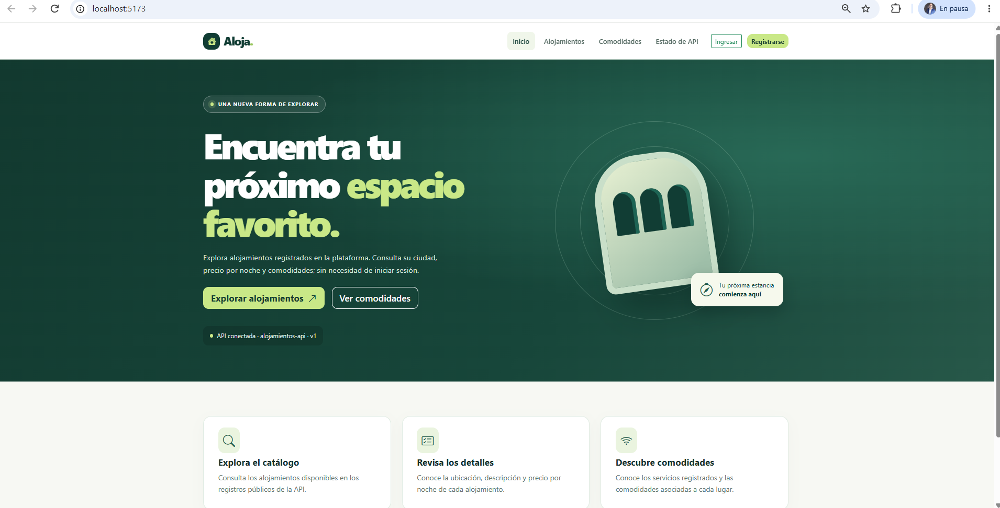
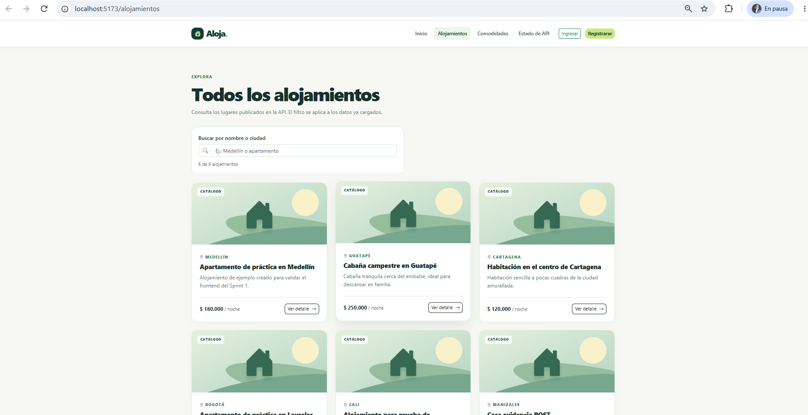
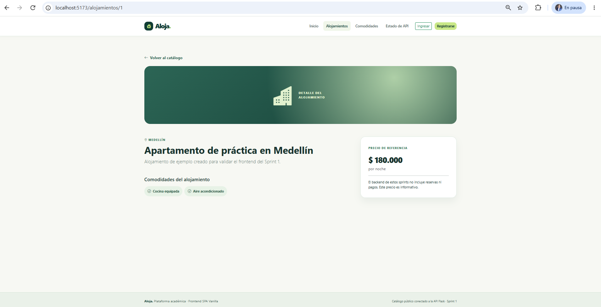
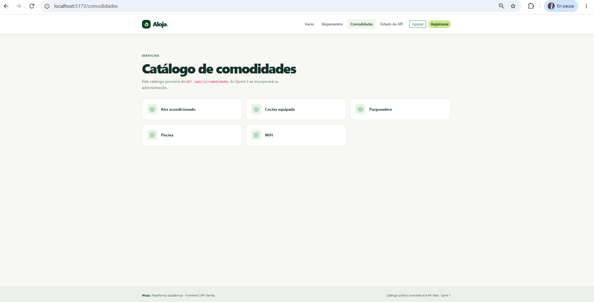
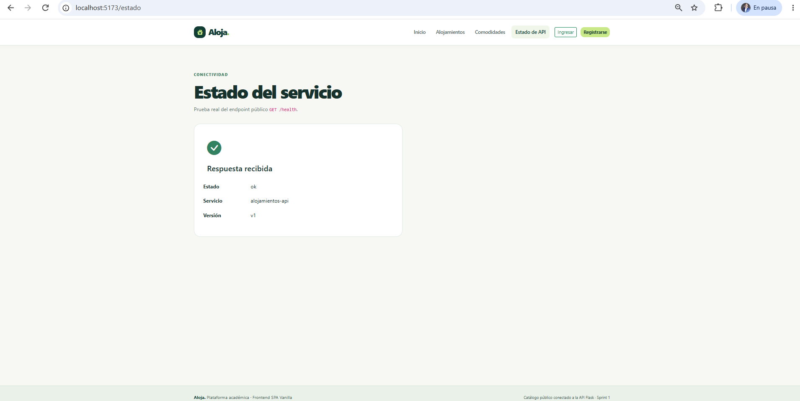

# Sprint 1: SPA pública

| Dato | Valor |
|---|---|
| Trabajo | Trabajo 1: Maquetación |
| Issue | #1 |
| Pull Request | #2 (fusionado en `main`) |
| Rama | `feat/frontend-sprint-01-spa-publica` |
| Pruebas al cierre | 9/9 |

## Objetivo

Construir la base de la aplicación como una SPA con JavaScript Vanilla, Vite y Bootstrap 5.3. La SPA muestra la información pública de la API Flask sin recargar la página.

## Funcionalidades implementadas

- **Router SPA** (`router/router.js`, `router/routes.js`): navegación con History API, enlaces con `data-link`, botón Atrás del navegador y página 404 para rutas desconocidas.
- **Inicio** (`/`): presentación del sistema y accesos al catálogo.
- **Catálogo** (`/alojamientos`): tarjetas responsive con título, ciudad, precio en COP y resumen.
- **Detalle** (`/alojamientos/:id`): información completa del alojamiento y sus comodidades. Solo acepta IDs enteros positivos.
- **Comodidades** (`/comodidades`): listado de las comodidades registradas.
- **Estado de la API** (`/estado`): consulta `GET /health` e indica si Flask está disponible.
- **Componentes reutilizables:** `Navbar`, `Footer`, `AlojamientoCard` y `Estados` (cargando, vacío y error).
- **Utilidades:** `escapeHtml` (evita inyección de HTML), `formatearCOP` y `resumen`.
- **Cliente HTTP** (`api/http.js`): conserva el código de estado y el mensaje de error de Flask, e informa cuando el servidor no responde.

## Endpoints consumidos

`GET /health`, `GET /api/v1/alojamientos`, `GET /api/v1/alojamientos/:id`, `GET /api/v1/comodidades`.

## Pruebas automatizadas (9)

| Archivo | Pruebas | Qué comprueba |
|---|:-:|---|
| `tests/api.test.js` | 3 | Rutas reales de la API, errores HTTP y Flask no disponible |
| `tests/formatters.test.js` | 3 | `escapeHtml`, formato COP y resumen de textos |
| `tests/routes.test.js` | 3 | Barra final en el catálogo, IDs válidos y página 404 |

## Resultados

- SPA navegable sin recargas, conectada a la API real.
- Diseño responsive con la rejilla de Bootstrap (móvil, tableta y escritorio).
- `npm test`: 9/9. `npm run build`: correcto.

## Evidencias

| Pantalla | Captura |
|---|---|
| Inicio |  |
| Catálogo de alojamientos |  |
| Detalle de un alojamiento |  |
| Comodidades |  |
| Estado de la API |  |