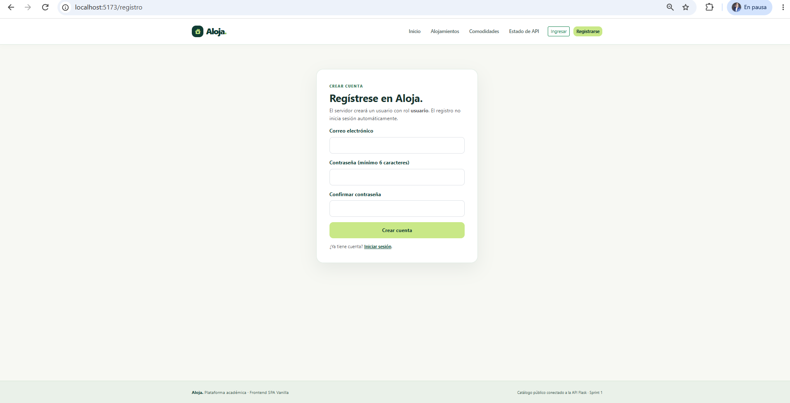
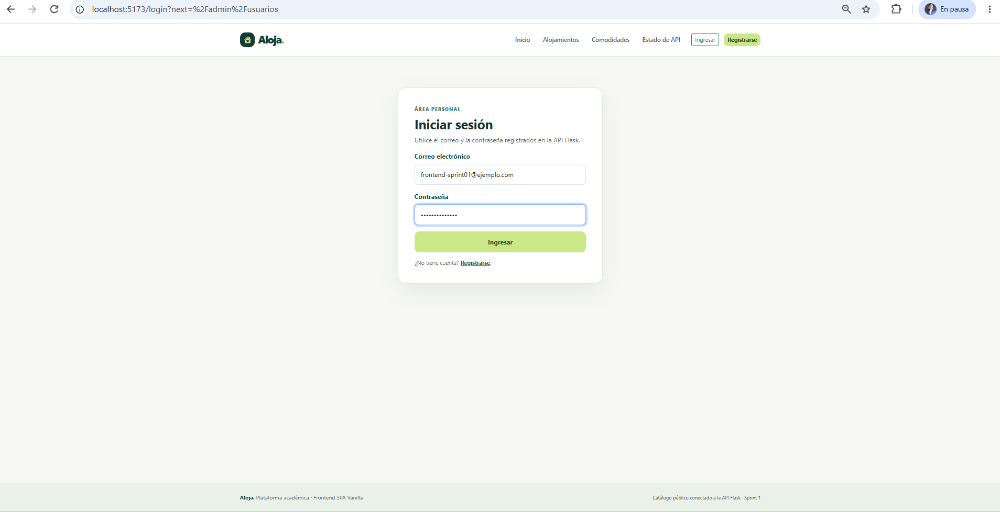
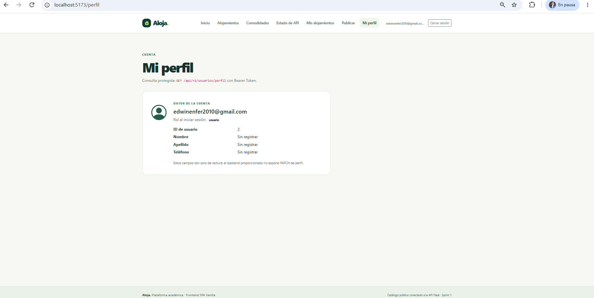
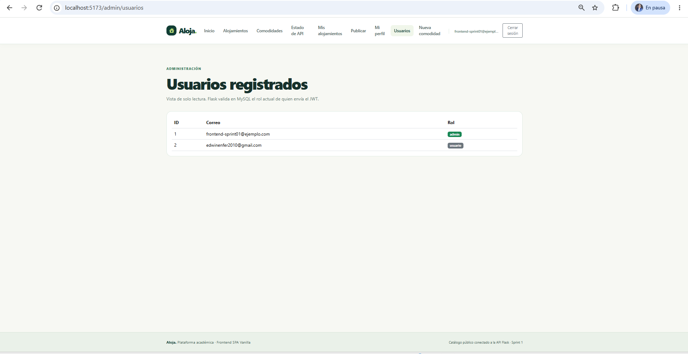
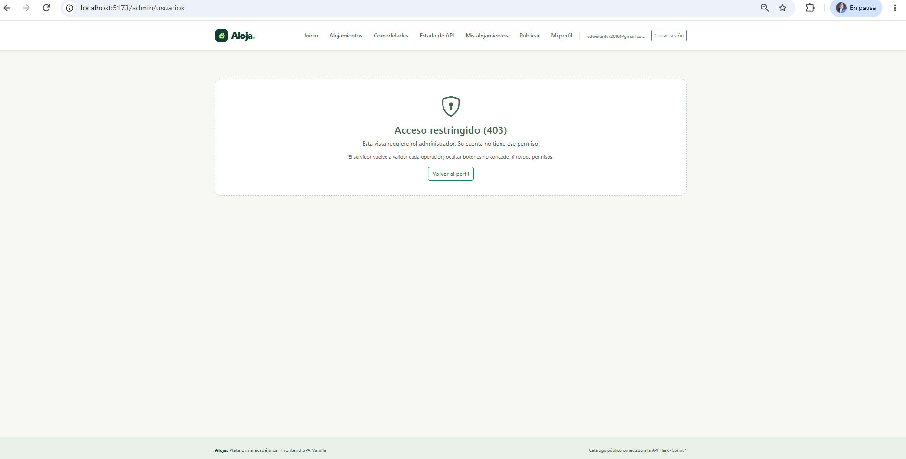

# Sprint 2: Registro, login JWT, sesión y roles

| Dato | Valor |
|---|---|
| Trabajo | Trabajo 2 |
| Issue | #3 |
| Pull Request | #4 (fusionado en `main`, merge `459245f`) |
| Rama | `feat/frontend-sprint-02-autenticacion` |
| Commit principal | `cd8d6d4` "feat: frontend registro login jwt y autorizacion" |
| Pruebas al cierre | 23/23 |

## Objetivo

Incorporar la autenticación con JWT emitido por Flask, el manejo de la sesión en el navegador y la autorización visual por roles (`usuario` y `admin`).

## Funcionalidades implementadas

- **Registro** (`/registro`): valida correo, longitud mínima de la contraseña y confirmación. Muestra los errores 400 y 409 (correo ya registrado) que devuelve Flask.
- **Login** (`/login`): envía las credenciales, recibe `access_token` y guarda la sesión. Si el usuario venía de una ruta privada, regresa a ella (`?next=`), pero solo hacia rutas internas conocidas.
- **Sesión** (`state/sesion.js`): se guarda en `sessionStorage` con la clave `alojamientos-sesion-v1`. Dura lo que la pestaña y descarta datos corruptos o roles desconocidos.
- **Perfil** (`/perfil`): consulta `GET /api/v1/usuarios/perfil` con `Authorization: Bearer`.
- **Cierre de sesión:** botón en el menú; borra la sesión y vuelve al inicio.
- **Menú dinámico:** muestra Ingresar/Registrarse al visitante y Perfil/Cerrar sesión al usuario autenticado; agrega "Usuarios" al administrador.
- **Guardas de ruta:** una ruta privada sin sesión redirige a `/login`; una ruta de administración sin rol `admin` muestra "No autorizado".
- **Administración** (`/admin/usuarios`): lista de usuarios desde `GET /api/v1/admin/usuarios`.
- **Expiración del token:** un 401 en una petición con token cierra la sesión. Un 401 en el login no borra una sesión previa.

## Endpoints consumidos

`POST /api/v1/usuarios/registro`, `POST /api/v1/usuarios/login`, `GET /api/v1/usuarios/perfil`, `GET /api/v1/admin/usuarios`.

## Pruebas automatizadas (14 nuevas; 23 en total)

| Archivo | Pruebas | Qué comprueba |
|---|:-:|---|
| `tests/auth-api.test.js` | 5 | Registro y login con JSON, Bearer en rutas privadas, manejo del 401 |
| `tests/sesion.test.js` | 3 | Guardar y cerrar sesión, rol admin, datos corruptos |
| `tests/validaciones.test.js` | 3 | Validación de registro y login, destinos seguros tras el login |
| `tests/permisos.test.js` | 3 | Rutas públicas, privadas y de administración |

## Resultados

- Registro y login funcionando con la API real (registro duplicado → 409).
- Usuario normal y administrador (promovido con `python -m scripts.promover_admin`) con menús distintos.
- `npm test`: 23/23. `npm run build`: correcto.

## Seguridad

- El token nunca se muestra en pantalla ni en las capturas.
- Ocultar opciones en el menú es solo una ayuda visual: Flask verifica el JWT y el rol en cada petición.

## Evidencias

| Pantalla | Captura |
|---|---|
| Registro |  |
| Login |  |
| Perfil |  |
| Usuarios (admin) |  |
| No autorizado (usuario normal) |  |