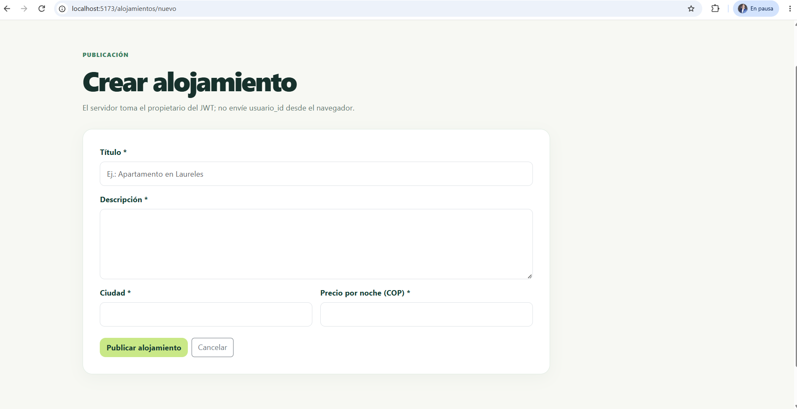
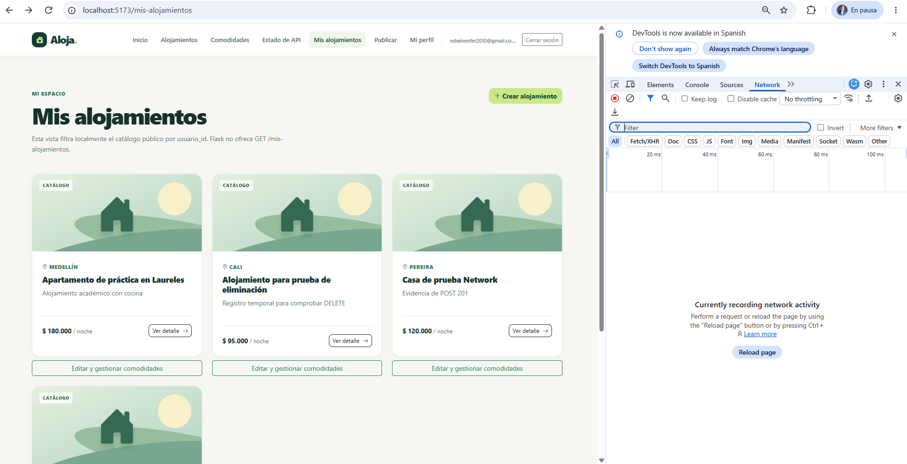
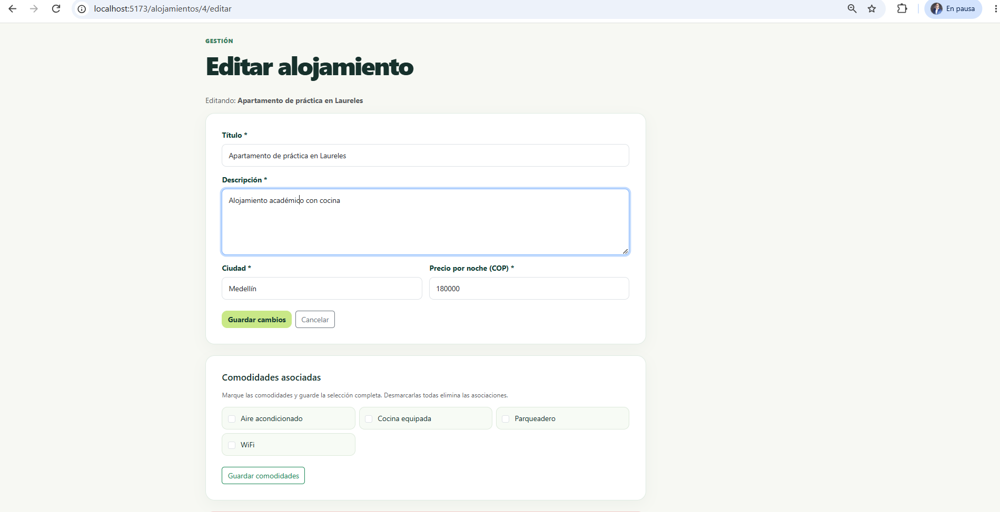
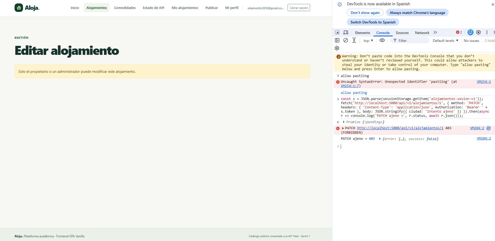
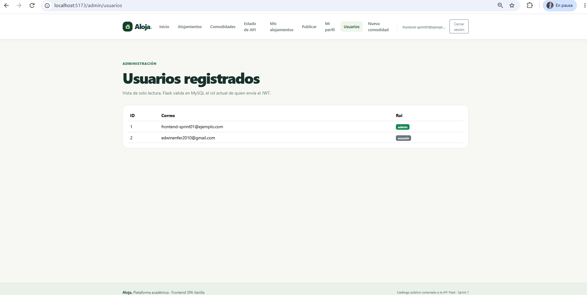
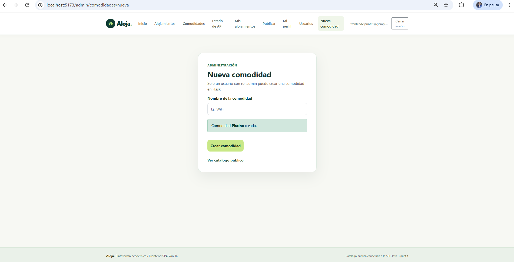
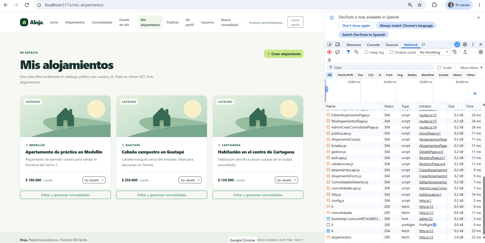
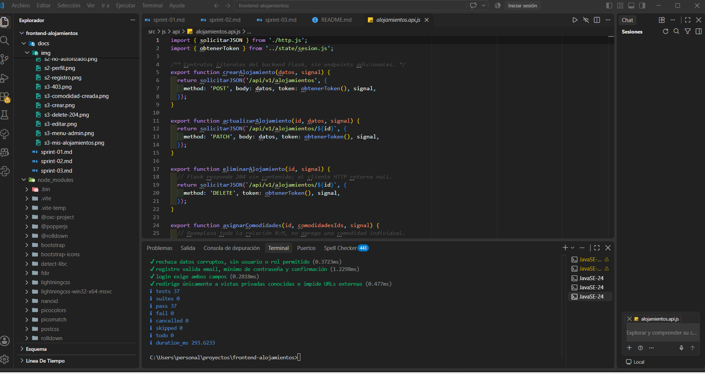
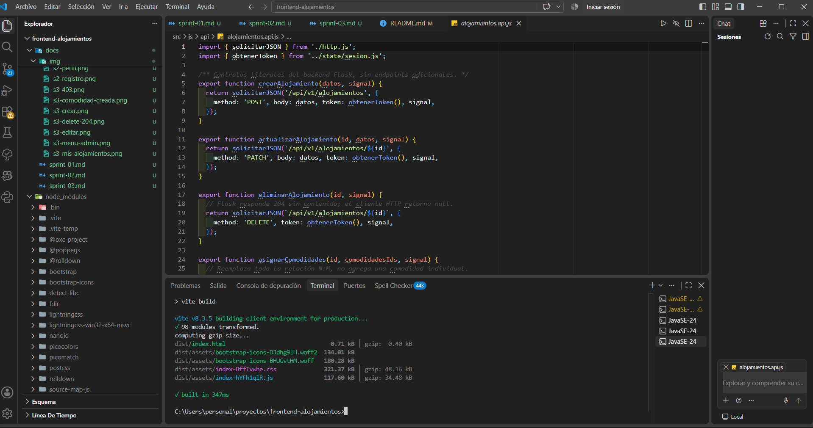
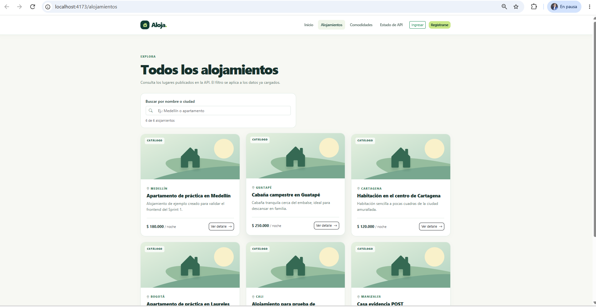

# Sprint 3: CRUD de alojamientos y comodidades

| Dato | Valor |
|---|---|
| Trabajo | Trabajo 3 |
| Issue | #5 |
| Pull Request | #6 (fusionado en `main`, merge `5d76e05`) |
| Rama | `feat/frontend-sprint-03-crud-comodidades` |
| Commit principal | `f558ca3` "feat: completar frontend CRUD y comodidades" |
| Pruebas al cierre | 37/37 |

## Objetivo

Permitir que los usuarios autenticados gestionen sus alojamientos (crear, consultar, editar y eliminar) y les asignen comodidades, y que el administrador cree comodidades nuevas. Todo respeta las reglas de propiedad y rol de la API Flask.

## Funcionalidades implementadas

- **Publicar** (`/alojamientos/nuevo`): formulario reutilizable `AlojamientoForm` con título (máx. 200), descripción, ciudad (máx. 100) y precio por noche (positivo, máx. dos decimales, `DECIMAL(10,2)`). Envía solo esos cuatro campos.
- **Mis alojamientos** (`/mis-alojamientos`): filtra el catálogo por el `usuario_id` de la sesión, porque la API no tiene un endpoint propio para esto.
- **Editar** (`/alojamientos/:id/editar`): modifica los datos con `PATCH`.
- **Comodidades del alojamiento:** componente `ComodidadesSelector` con casillas; `PATCH .../comodidades` reemplaza la lista completa y acepta `[]`.
- **Eliminar:** `DELETE` con confirmación; Flask responde 204 sin cuerpo y el cliente lo interpreta como `null`.
- **Nueva comodidad** (`/admin/comodidades/nueva`, solo admin): `POST /api/v1/comodidades`; un nombre repetido muestra el 409 de Flask.
- **Permisos visuales:** el enlace "Editar" del detalle solo aparece al propietario o al admin (`puedeModificar`).
- **Menú:** "Mis alojamientos" y "Publicar" para usuarios autenticados; "Nueva comodidad" para el admin.

## Endpoints consumidos

`POST /api/v1/alojamientos`, `PATCH /api/v1/alojamientos/:id`, `DELETE /api/v1/alojamientos/:id`, `PATCH /api/v1/alojamientos/:id/comodidades`, `POST /api/v1/comodidades`.

## Pruebas automatizadas (14 nuevas; 37 en total)

| Archivo | Pruebas | Qué comprueba |
|---|:-:|---|
| `tests/crud-api.test.js` | 5 | POST, PATCH, PATCH comodidades (incluso `[]`), DELETE 204, POST comodidad y 409 |
| `tests/gestion.test.js` | 4 | Validaciones, campos enviados, permisos visuales y selección vacía |
| `tests/gestion-componentes.test.js` | 2 | El formulario y el selector escapan el HTML |
| `tests/gestion-routes.test.js` | 3 | Rutas CRUD protegidas, ruta admin y destinos del login |

## Verificación con la API real (01/11/2026)

| Operación | Resultado |
|---|---|
| Crear alojamiento | 201 |
| Editar alojamiento propio | 200 |
| Asignar comodidades (y lista vacía) | 200 |
| Eliminar alojamiento y consultarlo después | 204 → 404 |
| Crear comodidad como admin | 201 |
| Crear comodidad duplicada | 409 |
| Usuario editando alojamiento ajeno / creando comodidad | 403 |
| Token vencido (15 min) | 401 → cierre de sesión |

## Corrección aplicada

En "Mis alojamientos", el botón "Editar y gestionar comodidades" se superponía con la fila siguiente por la clase `h-100` de la tarjeta. Se corrigió con dos reglas al final de `main.css`:

```css
#mis-lista .row > [class*="col-"] { display: flex; flex-direction: column; }
#mis-lista .stay-card { flex: 1 1 auto; height: auto !important; }
```

## Resultados

- CRUD completo integrado con Flask y MySQL, con restricciones de propiedad y rol.
- `npm test`: 37/37. `npm run build` y `npm run preview`: correctos.

## Evidencias

| Pantalla | Captura |
|---|---|
| Publicar alojamiento |  |
| Mis alojamientos |  |
| Editar y asignar comodidades |  |
| Usuario sin permiso (403) |  |
| Menú del administrador |  |
| Nueva comodidad creada |  |
| Eliminación (204) |  |

## Evidencias de la entrega final

| Comando | Captura |
|---|---|
| `npm test` (37/37) |  |
| `npm run build` |  |
| `npm run preview` |  |